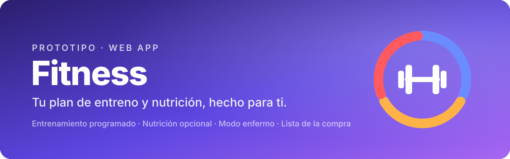
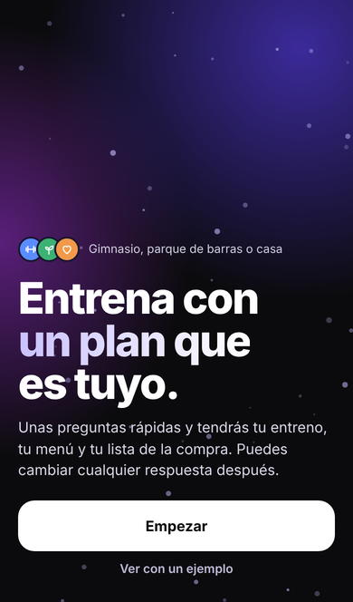
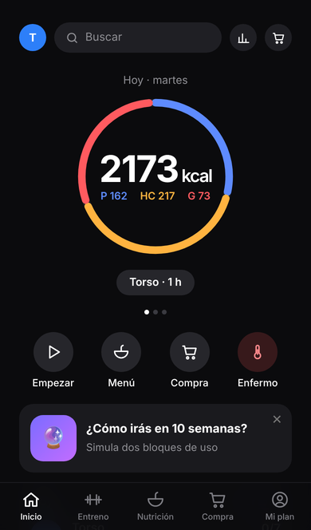
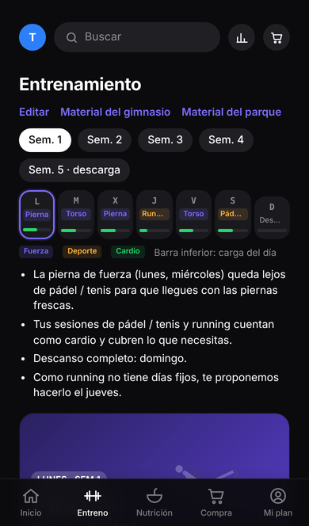
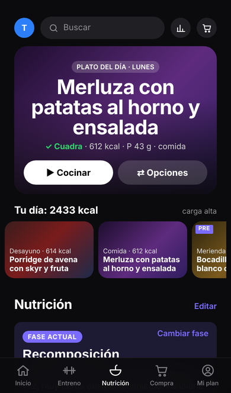
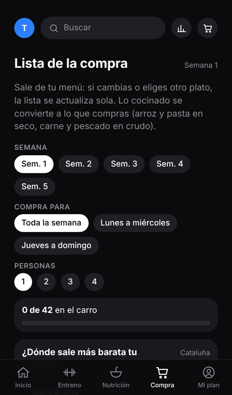
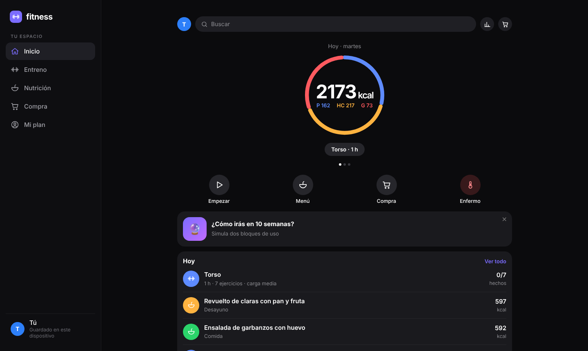

<p align="center">
  
</p>

<p align="center">
  <a href="https://pabmax.github.io/fitness-app/"></a>
  &nbsp;
  
  &nbsp;
  
</p>

<p align="center">
  Una app web que crea un <b>plan de entrenamiento programado</b> a tu medida y, si quieres, tu <b>plan de nutrición</b>.<br>
  Funciona entera en el navegador, en un solo archivo, sin servidor ni registro.
</p>

---

## 📱 Así se ve

<p align="center">
  
  
  
  
  
</p>
<p align="center"><sub>Cuestionario · Hoy · Entreno · Nutrición · Compra</sub></p>

<p align="center">
  
</p>
<p align="center"><sub>En el ordenador (pantallas 16:9) se muestra como web, con barra lateral y contenido en columnas; en el móvil, con barra inferior.</sub></p>

---

## ✨ Qué hace

| | |
|---|---|
| 🧭 **Cuestionario inicial** | Una pregunta por pantalla, con tarjetas, ruedas para edad, altura y peso, una silueta para marcar la lesión, una previsión a 10 semanas y la creación del plan en directo. |
| 🏋️ **Entrenamiento** | Plan semanal que combina fuerza, deportes y cardio. Volumen por músculo, bloques de 5 semanas con descarga, sustitutos de ejercicios y hora de entreno por día. |
| 🩹 **Lesiones** | Readaptación progresiva de la zona lesionada, integrada en el plan. |
| 📈 **Registro y progreso** | Series con peso, repeticiones y RIR, predicción de cargas, gráficas por sesión, ejercicio y bloque. Incluye una simulación de 10 semanas. |
| 🥗 **Nutrición** | Fases (mantenimiento, volumen, definición, recomposición), macros por día según la carga, macros editables por kg y menú semanal con recetas paso a paso. Las comidas pre y post entreno se adaptan al tiempo que falta para entrenar. |
| 🤒 **Modo enfermo** | Marca los días de enfermedad desde Entreno o Nutrición: el plan, la dieta y el histórico se adaptan sin contarlo como fallo, con una vuelta gradual. |
| 🛒 **Lista de la compra** | Se genera desde el menú, con checklist por secciones del súper, presupuesto y comparativa del precio medio entre supermercados de tu provincia. |
| 👥 **Perfiles** | Varias personas en el mismo dispositivo, cada una con su plan. |
| 🔬 **Base científica** | Fuentes de cada parámetro, separando evidencia y criterio práctico. |

---

## 📲 Instalar en el móvil

1. Abre **[pabmax.github.io/fitness-app](https://pabmax.github.io/fitness-app/)** en **Safari** (iPhone) o **Chrome** (Android).
2. Pulsa **Compartir → Añadir a pantalla de inicio**.
3. Se abre a pantalla completa, con su icono, y funciona sin conexión.

> Los datos se guardan solo en tu dispositivo (`localStorage`). No se envía nada a ningún servidor.

---

## 🗂️ Estructura

```
fitness-app/
├── index.html               # La app completa (HTML + CSS + JS en un archivo)
├── manifest.webmanifest     # Permite instalarla como app
├── sw.js                    # Uso sin conexión
├── icono-192.png · icono-512.png · apple-touch-icon.png · favicon.svg
├── docs/                    # Imágenes de este README
└── herramientas-imagenes/   # Generación de fotos de ejercicios
    ├── banco-prompts.html       # Banco de prompts por ejercicio y lugar
    ├── prompts-ejercicios.csv   # Los 172 prompts en CSV
    └── generar_lote.py          # Generación en lote con Stable Diffusion
```

Para las imágenes, `generar_lote.py` usa la API local de Automatic1111 o Forge:

```bash
python herramientas-imagenes/generar_lote.py --prueba 4
```

---

## 🛣️ Próximos pasos

- [ ] Volver a activar las funciones de IA con un servidor propio
- [ ] Fotos reales de los ejercicios
- [ ] Lista de la compra conjunta entre perfiles
- [ ] Color de marca propio

---

<p align="center">
  <sub>Prototipo. Antes de un lanzamiento real, los parámetros deben revisarlos un preparador físico, un fisioterapeuta y un dietista-nutricionista.</sub>
</p>
